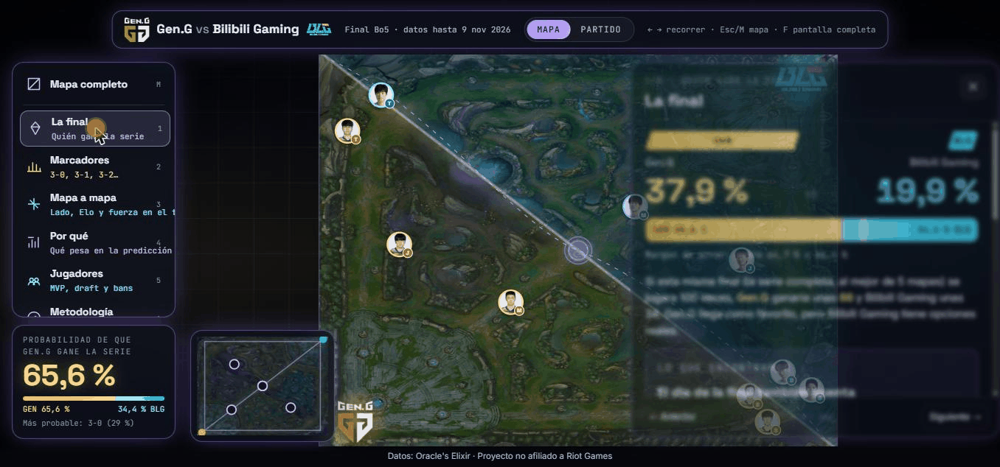
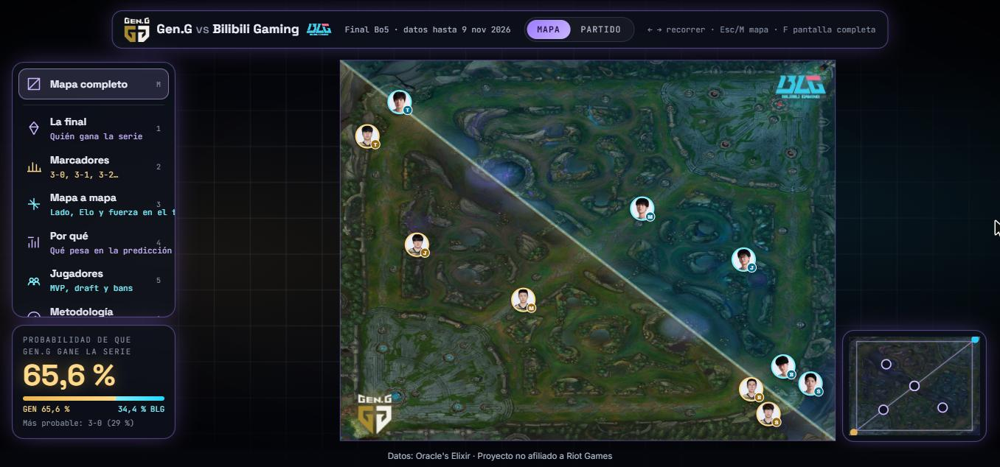
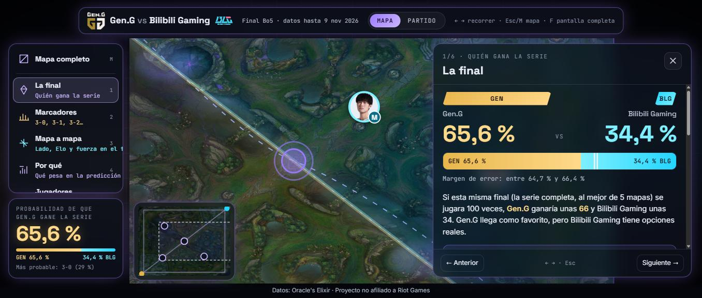
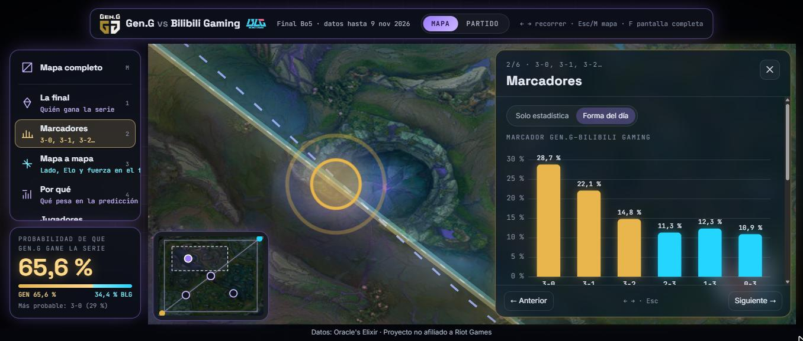
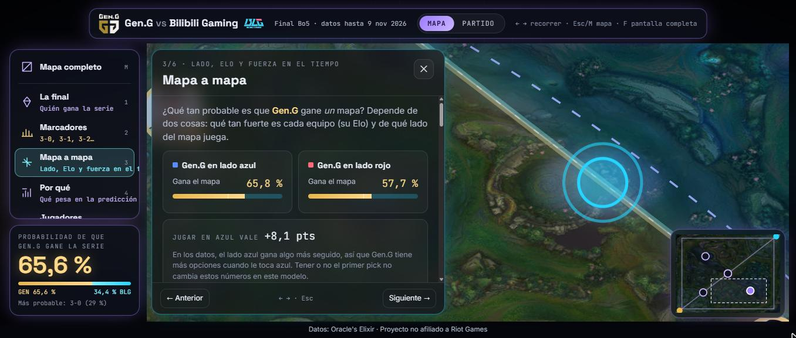
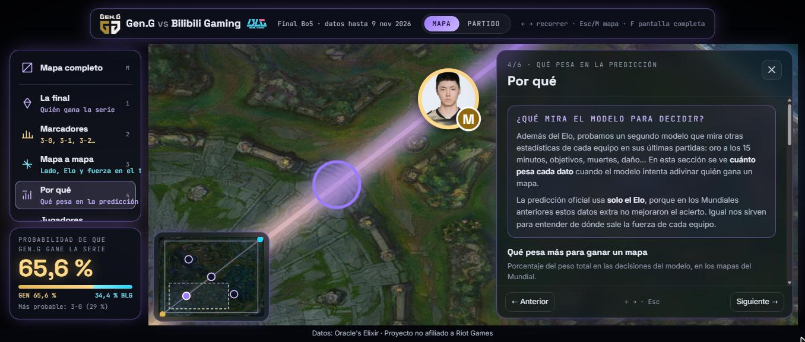
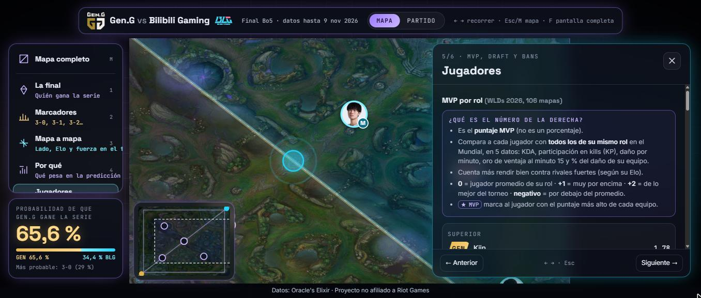
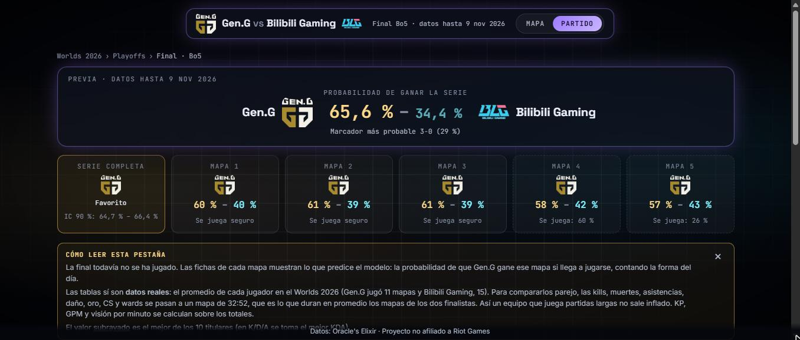
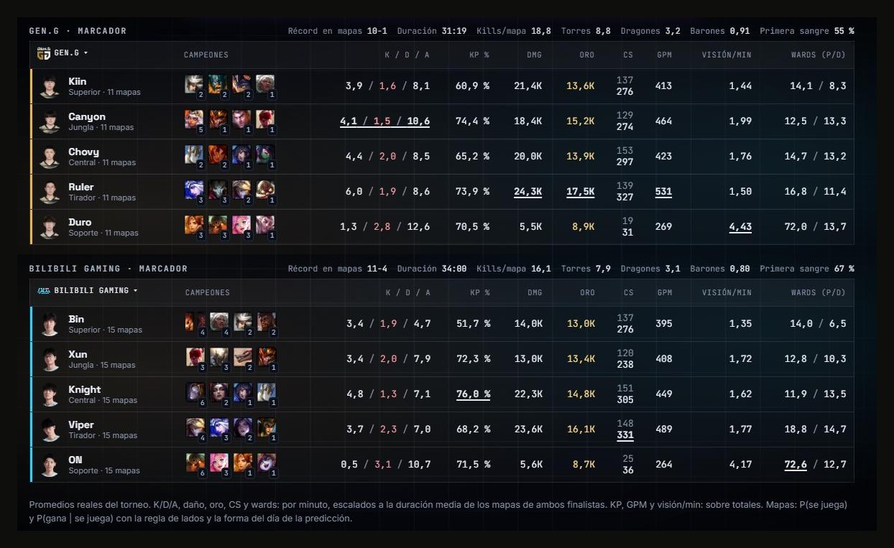

# LoL Worlds 2026 Final Predictor: Gen.G vs Bilibili Gaming

[Español](README.md) · **English**

[](https://lol-worlds-2026-predictor.vercel.app)  

Machine learning pipeline that estimates each team's chances in the Worlds 2026 Bo5 final, using real Oracle's Elixir data, leak-free temporal validation and a map-by-map Monte Carlo simulation. Includes an interactive Angular dashboard.

[](https://lol-worlds-2026-predictor.vercel.app)

---

## Result

| | Gen.G | Bilibili Gaming |
|---|---|---|
| **P(win the series)** | **65.6%** (64.7 – 66.4%) | 34.4% |
| Most likely score | **3-0 Gen.G (28.7%)** | |
| P(map) on blue side | 65.9% | |
| P(map) on red side | 57.7% | |

Data cutoff: November 9, 2026. Interval: bootstrap with 200 resamples.

## Method

1. **Data.** Oracle's Elixir CSVs, `position == 'team'` rows, leagues LCK, LPL, LEC, LCS, MSI and WLDs (Worlds).
2. **Elo.** Starts at 1500, K = 16 (×4 at MSI and Worlds), +30 for blue side and 25% regression to the mean each year. Elo is stored **before** each update.
3. **Candidate models.** Elo only, logistic regression and LightGBM with rolling features (`shift(1)` before every window).
4. **Form of the day.** A factor shared by every map in a series: if a team shows up in form, it is in form for all five maps. Fitted on 411 real Bo5 series.
5. **Simulation.** Monte Carlo with 100,000 series. The loser of the previous map picks the side; in 2026 teams chose red 76% of the time and first pick 63% of the time.

### Model comparison (log-loss; coin flip = 0.693)

| Model | Worlds 2025 (selection) | Worlds 2026 (evaluation) | Accuracy 2026 |
|---|---|---|---|
| **(a) Elo only** | **0.6557** | **0.6455** | 59% |
| (b) Logistic regression | 0.6562 | 0.6459 | 61% |
| (c) LightGBM | 0.7009 | 0.6591 | 61% |

Plain Elo beat LightGBM. With few international series, the complex model overfits and its probabilities come out worse calibrated.

### Effect of form of the day

| | Without adjustment | With adjustment | Actual |
|---|---|---|---|
| 3-0 rate | 30% | 38% | 37% |
| P(Gen.G wins the series) | 71.4% | 65.6% | — |

## Web dashboard

Angular 22 with navigation over a map. **Demo:** https://lol-worlds-2026-predictor.vercel.app

Each section is a point on the map: selecting it zooms the camera into that area and opens its panel. Use ← → to move between sections, `M` to return to the full map and `F` for full screen. The interface is in Spanish.



| The final | Scorelines (with form of the day) |
|---|---|
|  |  |
| **Map by map** | **Why** |
|  |  |
| **Players** | **Match view** |
|  |  |

**Player dashboard (Match view).** Real Worlds 2026 averages for every starter: K/D/A, KP, damage, gold, CS, GPM, vision and wards, plus each team's record and objectives.



## Usage

**Dashboard only (Windows):** run `ver_tablero.bat`.

**Full pipeline (Windows):**
```bat
instalar.bat          :: creates the environment and installs dependencies
correr_modelo.bat     :: ETL → Elo → models → simulation → web export
```

**Manual:**
```bash
pip install -r requirements.txt
python scripts/run_pipeline.py
python scripts/predict_series.py
python scripts/export_web.py
pytest            # includes test_no_leakage
```
Put the Oracle's Elixir CSVs in `data/raw/`. Parameters live in `config.yaml`. For more details, see `LEEME_INSTALACION.md` (in Spanish).

## Structure

| Path | Contents |
|---|---|
| `src/lolpred/` | `etl`, `elo`, `features`, `modeling`, `simulation`, `explain` |
| `scripts/` | Pipeline run, prediction and web export |
| `tests/` | Tests, including the no-leakage test |
| `web/` | Angular dashboard |
| `reports/` | Figures and screenshots |
| `config.yaml` | Parameters |

## Limitations

- There are few international matchups, so the LCK vs LPL comparison depends on MSI and Worlds.
- Patch and roster changes within the season are not modeled.
- The dashboard is not adapted for mobile yet. For now it only looks right on desktop.
- An accuracy around 60% is expected. What matters is calibration, not picking the winner.

---

Data: Oracle's Elixir · Not affiliated with Riot Games
