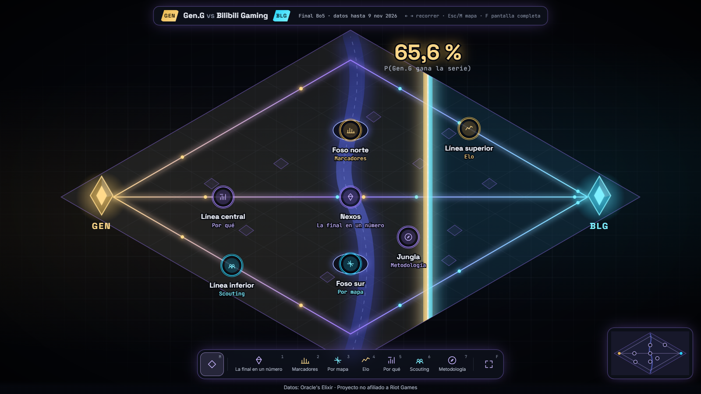
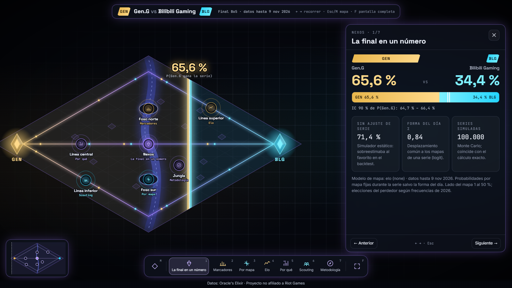
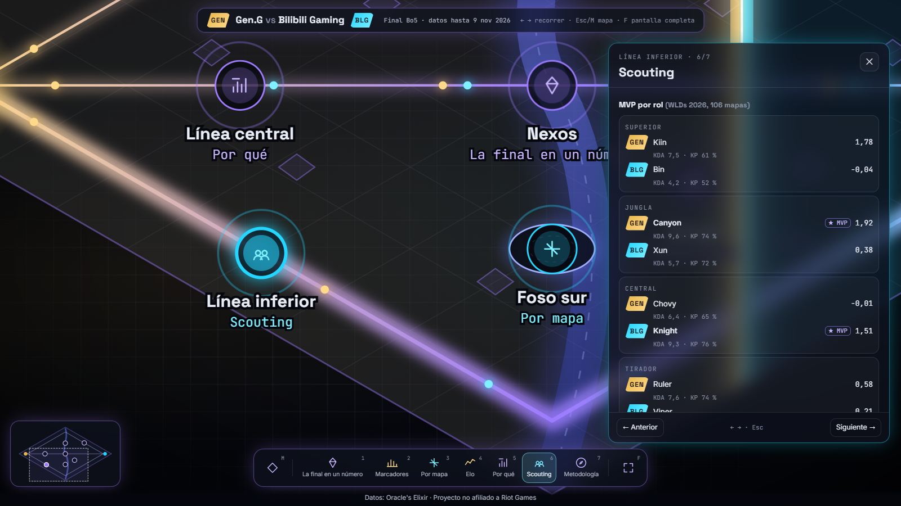

# Predictor de la final del Mundial 2026 de League of Legends

**Gen.G vs Bilibili Gaming, al mejor de 5.** Un modelo que calcula quién tiene más opciones de ganar la final, con
datos reales de partidas profesionales, y una web interactiva para explorarlo sobre el mapa de la Grieta.



## El resultado

| | |
|---|---|
| Probabilidad de que Gen.G gane la serie | **65,6 %** (margen: 64,7 % – 66,4 %) |
| Marcador más probable | 3-0 para Gen.G (28,7 %) |
| Probabilidad de que Gen.G gane un mapa | 65,9 % en lado azul · 57,7 % en lado rojo |

Datos hasta el 9 de noviembre de 2026, antes de la final.

## Lo que encontramos

**El día de la final también cuenta.** Revisando 411 series reales a 5 mapas vimos que los mapas de una misma serie
van muy ligados: si un equipo llega bien, normalmente juega bien toda la serie, y si llega mal, también. Un simulador
que trata cada mapa por separado daba muy pocos 3-0 (30 % frente al 37 % real) y confiaba demasiado en el favorito.

Lo modelamos como una "forma del día" que se sortea en cada serie y afecta a todos sus mapas. Con eso los 3-0
predichos pasan a 38 %, y la probabilidad de Gen.G baja de 71,4 % a 65,6 %.

**El modelo simple ganó.** Comparamos tres modelos para predecir un mapa, siempre probando en un Mundial que el modelo
no había visto:

| Modelo | Log-loss Mundial 2025 | Log-loss Mundial 2026 | Aciertos 2026 |
|---|---|---|---|
| (a) Solo Elo | **0,6557** | **0,6455** | 59 % |
| (b) Regresión logística (Elo + lado + primer pick) | 0,6562 | 0,6459 | 61 % |
| (c) LightGBM (+ estadísticas recientes) | 0,7009 | 0,6591 | 61 % |

Tirar una moneda da 0,693. El Elo empata con la logística y le gana a LightGBM, así que la predicción usa el Elo.

## Cómo funciona

1. **Datos.** Partidas de LCK, LPL, LEC, LCS, LCP, CBLOL, MSI y Mundial de 2024 a 2026
   ([Oracle's Elixir](https://oracleselixir.com/tools/downloads)). 2024 solo sirve de historial previo para el Elo.
2. **Elo por equipo.** Empiezan en 1500, K = 16 (×4 en MSI y Mundial), +30 puntos al lado azul y regresión a la
   media del 25 % cada año. Parámetros elegidos por log-loss en el Mundial 2025.
3. **Validación solo por fechas.** El Mundial 2025 sirve para elegir modelo y el Mundial 2026 solo para evaluar. Las
   estadísticas móviles usan `shift(1)` y el Elo se guarda antes de actualizarse, así que ningún mapa ve su propio
   resultado.
4. **Regla de lados de 2026.** El perdedor de cada mapa elige; sale de los datos (rojo el 76 %, primer pick el 63 %).
5. **Montecarlo.** La final se simula 100.000 veces mapa a mapa, con la forma del día, y se comprueba con un cálculo
   exacto.
6. **Margen de error.** Bootstrap de 200 repeticiones sobre las partidas de entrenamiento.

El detalle está en [reports/](reports/) y en la sección "Metodología" de la web.

## La web

Angular 22 con signals, ECharts y GSAP. El mapa es la portada: cada botón lleva la cámara a una parte de la
predicción (la final, marcadores, mapa a mapa y Elo, qué pesa en el modelo, jugadores y draft, metodología). Al hacer
clic en un jugador la cámara va a su línea.

| | |
|---|---|
|  |  |

## Correrlo

**Solo la web** (los resultados ya vienen en `web/src/assets/data/`):

```bash
cd web
npm install
npm start          # http://localhost:4200
npm test -- --watch=false
```

**El modelo completo** (Python 3.11+). Descarga los CSV de 2024, 2025 y 2026 de
[Oracle's Elixir](https://oracleselixir.com/tools/downloads) y ponlos en `data/raw/`:

```bash
python -m venv .venv
.venv\Scripts\activate          # Windows (en Mac/Linux: source .venv/bin/activate)
pip install -r requirements.txt
python scripts/run_pipeline.py --rapido
python scripts/predict_series.py
pytest -q
```

En Windows, `instalar.bat` hace todo esto solo. Más detalle en [LEEME_INSTALACION.md](LEEME_INSTALACION.md).

## Estructura

| Carpeta | Contenido |
|---|---|
| `src/lolpred/` | ETL, Elo, features, modelos, simulación del Bo5, verificación, scouting, SHAP |
| `scripts/` | Pipeline completo, predicción y exportación a la web |
| `tests/` | Tests de Python (incluido uno anti-leakage) con datos sintéticos |
| `reports/` | EDA, métricas, gráficos y capturas |
| `web/` | Tablero en Angular, con tests en Vitest |
| `config.yaml` | Todos los parámetros |

---

Datos: Oracle's Elixir · Proyecto no afiliado a Riot Games ni a los equipos. Las imágenes de equipos, jugadores,
campeones y del mapa pertenecen a sus dueños y se usan solo para ilustrar.
